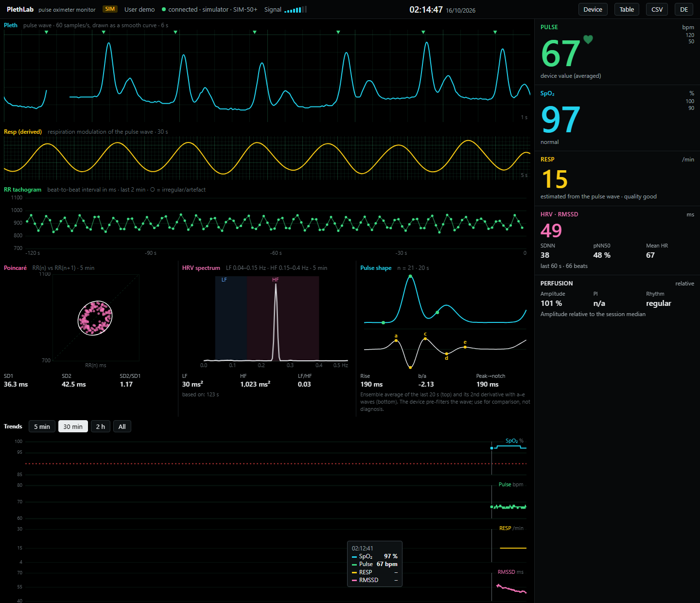

# PlethLab

**A bedside-style monitor and HRV lab for CMS50D+-compatible USB pulse oximeters.**

PlethLab reads the live data stream of an inexpensive fingertip pulse oximeter over USB and
turns it into a browser dashboard: pulse wave on ECG-paper grid, SpO₂ and pulse numerics with
alarms, a respiration rate and waveform derived from the pulse wave, beat-to-beat HRV,
Poincaré plot, HRV spectrum, ensemble-averaged pulse shape, trends and CSV logging. It can also
read recordings stored on the device and set the device clock.



> **Not a medical device.** PlethLab is for curiosity, self-tracking and experiments. It does
> not diagnose anything. All derived values (respiration, HRV, rhythm, pulse shape) are
> estimates from a pre-filtered 60 Hz pulse wave.

## Features

- **Live monitor:** pleth sweep with beat markers, SpO₂, pulse, signal strength, sensor
  messages (no finger, weak signal, disconnected) and alarm limits
- **Respiration:** rate and a derived waveform, fused from rate, amplitude and baseline
  modulation of the pulse wave, with a quality indicator
- **HRV:** beat detection with sub-sample timing (validated against the device's own beat
  markers), RMSSD, SDNN, pNN50, RR tachogram with artefact marking
- **Poincaré plot** with SD1/SD2 ellipse and **HRV spectrum** (LF, HF, LF/HF, 5 min window)
- **Pulse shape:** ensemble average of the last 20 s, second-derivative (SDPPG) a–e waves,
  b/a ratio, rise time and peak-to-notch time
- **Trends** for SpO₂, pulse, respiration and RMSSD with synced crosshair, table view
- **Device storage:** list and download recordings (with min SpO₂, mean pulse and ≥3 %
  desaturation count), set the device clock
- **CSV logs** per session plus a separate beat-to-beat (RR) log
- **English and German** interface
- **Simulator mode** for trying it without hardware

## Quick start

```bash
pip install -r requirements.txt
python server.py            # auto-detects the CP210x USB cable
# or: python server.py COM5  /  python server.py /dev/ttyUSB0
```

Open <http://localhost:8050>, put your finger in the oximeter and switch it on.
Respiration and HRV appear after 30–60 s of calm measurement, the HRV spectrum after 2 min.

No device at hand? Run `python server.py --simulate`.

On Windows the CP210x driver from Silicon Labs may be needed. On Linux, add your user to the
`dialout` group.

## Supported devices

PlethLab speaks the serial protocol of the Contec CMS50D+ family (see [PROTOCOL.md](PROTOCOL.md)).
Devices only work if they come with a **USB data cable / PC software**.

| | Device | Status | Amazon.de (EU) | Amazon.com (US) |
|---|---|---|---|---|
|  | **PULOX PO-250** (reports as CMS50D+) | ✅ tested | [view](https://www.amazon.de/dp/B004ZQ2WWO?tag=5gready-21&linkCode=osi&th=1&psc=1) | [Contec CMS50D+](https://www.amazon.com/s?k=Contec+CMS50D%2B+pulse+oximeter&tag=5gready-20) |
|  | PULOX PO-300 (with long-term recording software) | ❔ untested | [view](https://www.amazon.de/dp/B0021D4G9A?tag=5gready-21&linkCode=osi&th=1&psc=1) | – |
|  | PULOX PO-400 (wrist-worn) | ❔ untested | [view](https://www.amazon.de/dp/B003ITM3WI?tag=5gready-21&linkCode=osi&th=1&psc=1) | – |

Tested a device that is not listed? Please open an issue with the model name the dashboard
shows in the header.

*As an Amazon Associate I earn from qualifying purchases. The links above are affiliate
links. Buying through them costs you nothing extra and supports this project.*

## How it works

```
pulse oximeter ── USB (CP2102, 115200 baud) ── server.py ── Server-Sent Events ── dashboard.html
                                                  │
                                            analysis.py (beats, HRV, respiration, pulse shape)
```

- `server.py`: serial reader, device commands, HTTP + SSE server, CSV logging
- `analysis.py`: signal analysis (numpy/scipy)
- `simulator.py`: protocol-level device simulator with a synthetic pulse wave
- `dashboard.html`: single-file UI, no build step, no external resources

The live stream delivers about 60 samples per second. This is fixed by the device firmware.
The dashboard draws a smooth curve through the samples but does not invent new ones.

## Tests

```bash
pip install -r requirements-dev.txt
python -m playwright install chromium
python -m pytest                     # unit tests + end-to-end browser test (simulator)
```

## Safety

PlethLab never sends commands that erase or reconfigure device storage (see PROTOCOL.md).
Writing the device clock is the only write operation and only happens when you click it.

## License and trademarks

MIT, see [LICENSE](LICENSE).

PULOX is a trademark of its owner. Contec and CMS50D+ are trademarks of Contec Medical
Systems. Names are used only to describe compatibility. PlethLab is not affiliated with,
endorsed by or supported by any of these companies.
